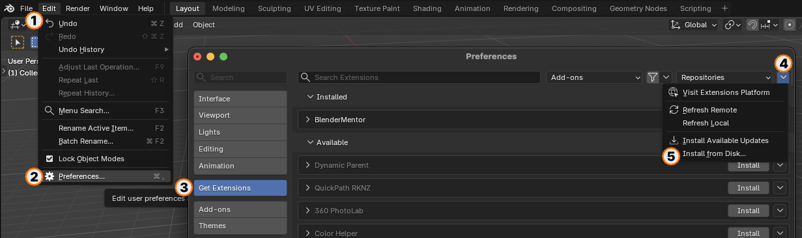
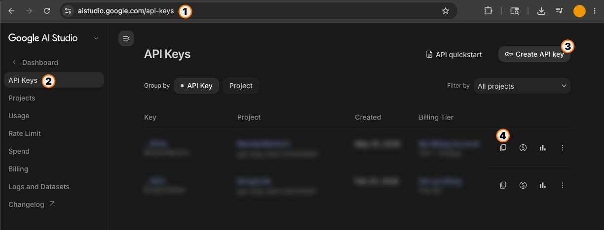
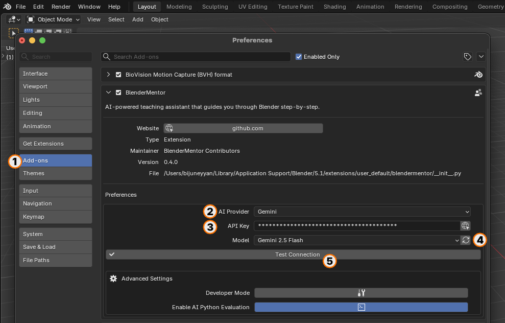
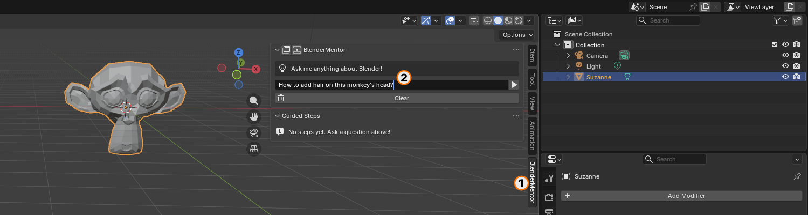
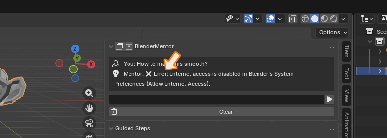
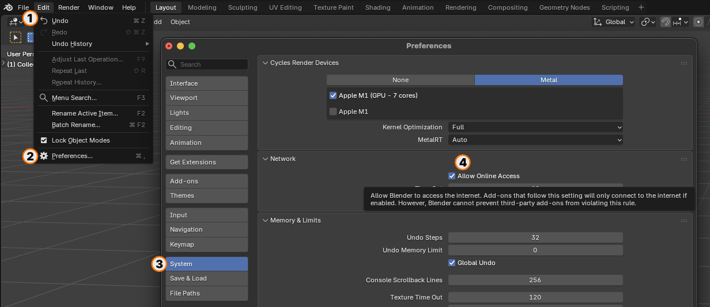
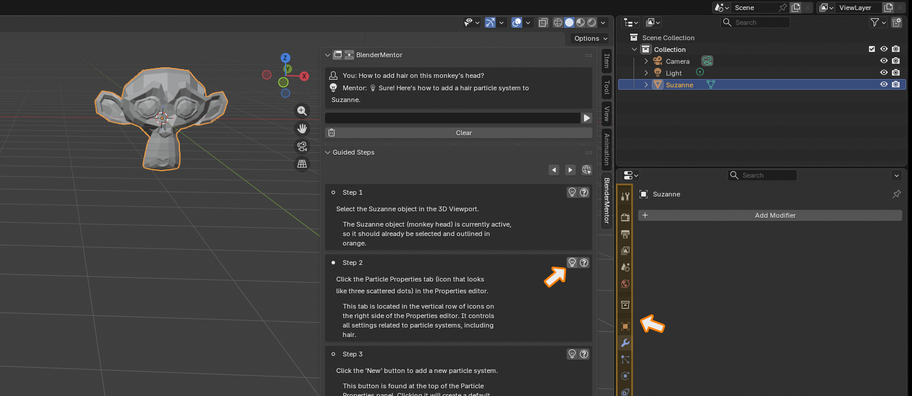

# 📖 BlenderMentor: Installation and Usage Instructions

Welcome to **BlenderMentor**! This guide provides comprehensive, step-by-step instructions on how to install, configure, and get the most out of your AI-powered teaching assistant directly inside Blender.

[🌐 Official Website](https://www.blendermentor.org) • [📦 Download Latest Release (v0.5.0)](https://github.com/blendermentor/blendermentor/releases/latest)

---

## 🚀 Part 1: Installation & Setup

BlenderMentor is fully compliant with the modern **Blender 4.2+ Extensions system** and also supports traditional Blender 4.0+ setups. Follow these steps to install and enable it.

### Step 1: Download the Add-on
*   Download the latest **`BlenderMentor-0.5.0.zip`** package from our [Releases page](https://github.com/blendermentor/blendermentor/releases/latest). 
*   *Note: Do not unzip the package; keep it as a `.zip` file.*

### Step 2: Access Blender Preferences
*   Launch Blender.
*   In the top-left menu bar, go to **Edit ➔ Preferences...** (or **Blender ➔ Preferences...** on macOS).
*   The Preferences window will open.

### Step 3: Install the Add-on

*   On the left sidebar of the Preferences window, select the **Get Extensions** tab.
*   In the top-right header of the Preferences window, click the **cog/gear icon** to open repository options.
*   Select **Install from Disk...** from the dropdown menu.
*   Navigate to your downloads, select **`BlenderMentor-0.5.0.zip`**, and click **Install**.
*   Blender will extract the extension, register it in your local `"User Default"` repository, and enable it automatically.

### Step 4: Configure Your AI API Key (Bring Your Own Key)

BlenderMentor runs locally and requires no registration or subscription on our end — you bring your own API key:
*   **Google Gemini**: Go to [Google AI Studio](https://aistudio.google.com), log in, and click **Get API Key** ➔ **Create API Key**.
*   **Anthropic Claude**: Obtain a key from the [Anthropic Console](https://console.anthropic.com).
*   **DeepSeek**: Create an API key at the [DeepSeek Platform](https://platform.deepseek.com).
*   **Ollama (Local)**: Run private offline models locally via [Ollama](https://ollama.com) (no key required).

### Step 5: Configure the Add-on Preferences

*   Back in Blender Preferences, select the **Get Extensions** tab (or **Add-ons** tab).
*   Locate **BlenderMentor** and click the small arrow next to its name to expand the details and settings panel.
*   Set **AI Provider** to your chosen provider (**Gemini**, **Claude**, **DeepSeek**, or **Ollama**).
*   Paste your copied key into the **API Key** field (the key is hidden as a password field for security).
*   Click **Fetch Models** (the file folder refresh icon). BlenderMentor will connect to the API, retrieve the active list of models, and populate the dropdown dynamically.
*   Select your preferred model (e.g., `gemini-2.5-flash` or `deepseek-chat`).
*   Click **Test Connection** (the checkmark icon) to confirm the key is active and working (`✓ Connection successful!`).

---

## 🛠 Part 2: How to Use BlenderMentor

Once configured, BlenderMentor lives in your 3D Viewport sidebar and is ready to teach you.

### Step 1: Open the Chat Panel
*   Hover your mouse over the main **3D Viewport**.
*   Press **`N`** on your keyboard to open the Sidebar panel on the right.
*   Select the **BlenderMentor** tab.

### Step 2: Ask a Question

*   **Type or Speak**: Type your question in the text input, or tap the square **Microphone** button (or press **`Alt + ↑`** / **`Option + ↑`**) to dictate hands-free.
*   **Submit**: Click **Send** (the Play icon) or press **Enter**.
*   **Cancel & Restore**: Press **`Alt + ↓`** (or click Cancel) to abort generation and restore your prompt into the input field for instant editing.
*   **Silence Voice Readout**: Click the **Speaker Stop** icon anytime to halt audio narration mid-sentence.

> 💡 **Voice Interactions & Browser Compatibility**: Voice dictation and audio narration leverage native browser capabilities (`Web Speech API` & `SpeechSynthesis`) via the Browser Companion (`http://localhost:8765`). Users should choose **Google Chrome** or **Microsoft Edge** as their browser for the best speech recognition accuracy and natural TTS voices.

#### Global Keyboard Shortcuts (Work Across Any Blender Window)
| Shortcut (Win / Linux) | Shortcut (macOS) | Action |
| :--- | :--- | :--- |
| **`Alt + ↑`** | **`Option + ↑`** | Toggle Voice Dictation (tap to listen, tap to send) |
| **`Alt + ↓`** | **`Option + ↓`** | Cancel generation / dictation & restore prompt |
| **`Alt + →`** | **`Option + →`** | Advance to Next Step globally |
| **`Alt + ←`** | **`Option + ←`** | Go back to Previous Step globally |

---

## 🌐 Troubleshooting: Internet Access Errors

Because Blender 4.2+ enforces strict system security, your addon might occasionally show an error banner when you try to submit a question:
> `⚠ Internet access is disabled in Blender's System Preferences (Allow Internet Access).`

### Why does this happen?
Blender has a global safety toggle designed to prevent extensions from connecting to the internet without your knowledge. BlenderMentor strictly respects this preference and will block all API calls if it is turned off.

### How to Fix It:

*   Go to **Edit ➔ Preferences...**
*   Select the **System** tab on the left sidebar.
*   Scroll down to the **Network** section.
*   Check the box to enable **Allow Internet Access**.
*   Close the preferences. You can now immediately send your questions successfully!

---

## 🎯 Part 3: Navigating Step-by-Step Guidance

When BlenderMentor responds, it won't just dump text in your face—it builds a structured learning path specifically for your scene.

### 1. Step-by-Step Response List
The panel renders a list of clear, single-action instructions. Click any step block directly to make it active.

### 2. UI Highlighting & the Lightbulb Icon (`'LIGHT'`)
*   Selecting a step automatically triggers a **visual colored outline** over the exact Blender editor, navigation tab, or button panel you need to interact with.
*   If the highlight fades or you need to see it again, click the **Lightbulb (`'LIGHT'`)** icon in the header of the active step to re-trigger the glow animation.

### 3. Asking Follow-Up Questions (`Ask ❓`)
*   If a specific step is confusing (e.g., you don't understand *why* you are adding a material, or a button is named differently on your screen), click the **Ask ❓** button right next to that step.
*   Type your question. The AI will receive the exact context of your current steps and answer your question directly in the chat, updating your guide seamlessly.

### 4. Searching YouTube Tutorials (`'URL'`)
*   Often, seeing a workflow in a video makes it click. If the AI detects a good fit for video learning, a **Globe (`'URL'`)** icon appears in the top navigation row.
*   Hover over the Globe to see the tooltip *"Search YouTube Tutorials"*.
*   Clicking it immediately opens your default browser with an AI-optimized search query focused exactly on your task, getting you high-quality video tutorials instantly.
