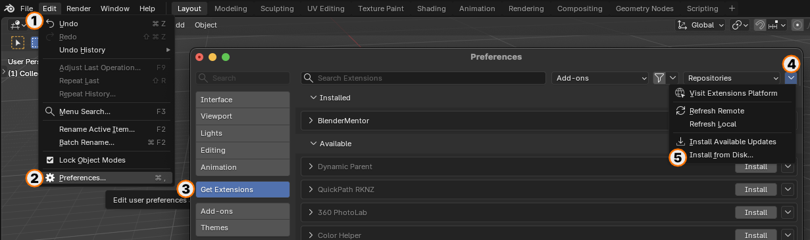
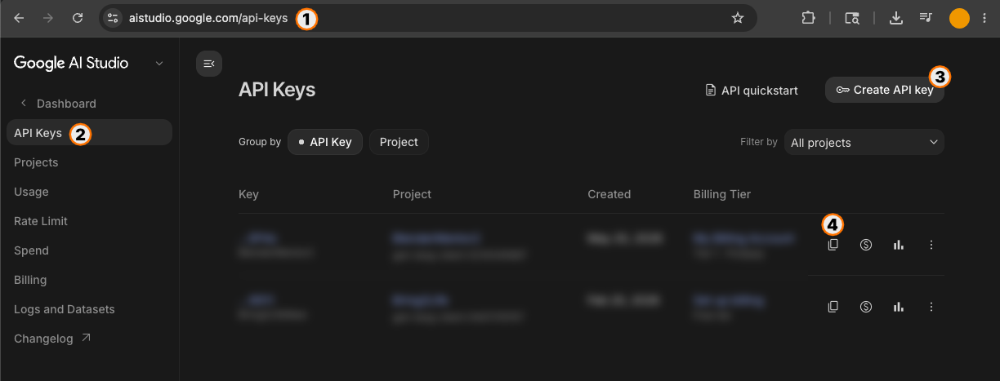
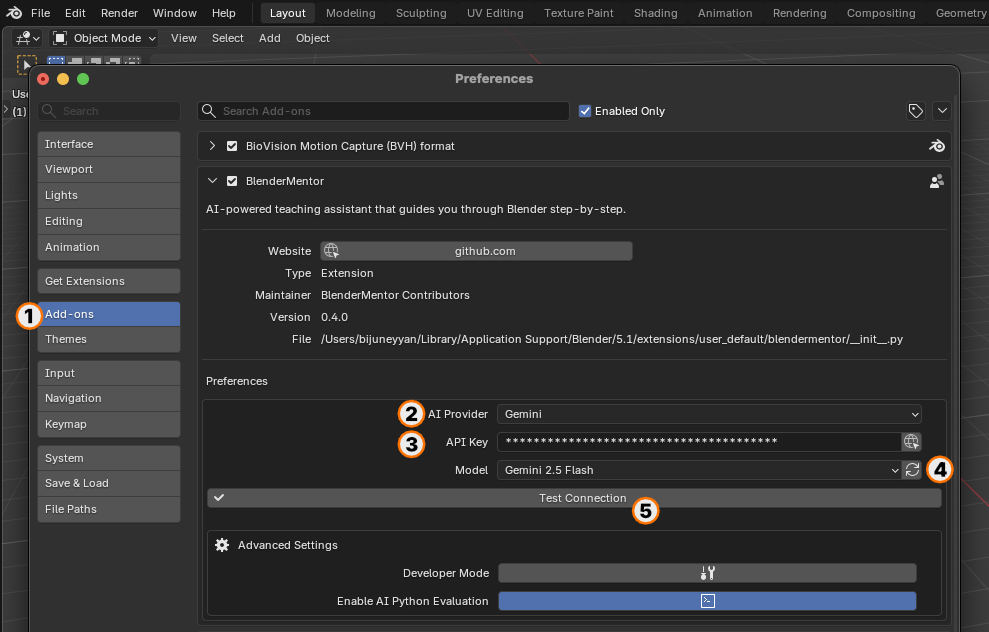
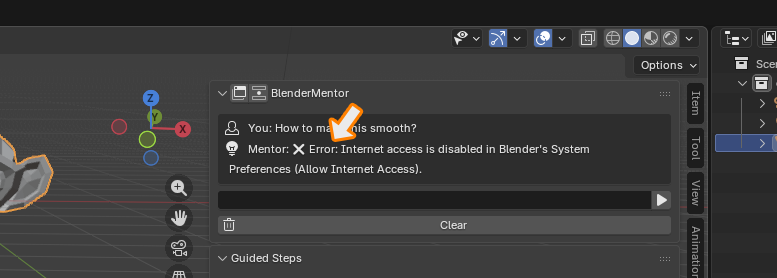
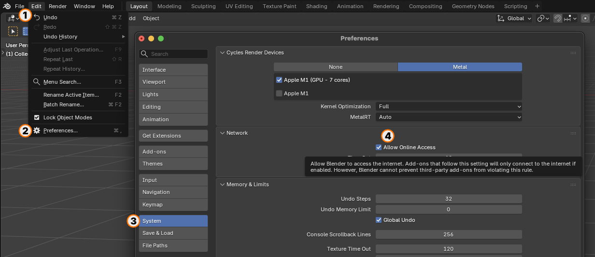

# BlenderMentor

**BlenderMentor** is an AI-powered teaching companion embedded directly inside Blender. It teaches you how to create by answering your questions, breaking complex workflows into step-by-step guidance, and visually highlighting relevant UI elements in real-time — without ever altering your scene on your behalf.

> ⚠️ This is a small side project, vibe-coded after work hours, very much a work in progress, and licensed under **GPL v3**.

BlenderMentor offers a **Dual Experience** tailored to your workflow:
1. **In-Viewport Remote Control (N-Panel)**: A clean, distraction-free companion in your 3D Viewport sidebar that shows only the active step, reasoning, and quick action controls.
2. **BlenderMentor Console (`http://localhost:8765`)**: An interactive dual-column web app built for second monitors, laptops, and tablets — featuring official Blender vector icons, hands-free voice dictation, live audio VU meter, and customizable voice readout.

---

## 🚀 Part 1: Installation & Setup

BlenderMentor is fully compliant with the modern **Blender 4.2+ Extensions system**.

### Step 1: Download the Add-on
* Download the latest `blendermentor_addon.zip` package from the [Releases](https://github.com/blendermentor/blendermentor/releases) page.
* *Note: Do not unzip the package; keep it as a `.zip` file.*

### Step 2: Access Blender Preferences
* Launch Blender.
* In the top-left menu bar, go to **Edit ➔ Preferences...** (or **Blender ➔ Preferences...** on macOS).

### Step 3: Install the Add-on

* On the left sidebar of the Preferences window, select the **Get Extensions** tab.
* In the top-right header, click the **cog/gear icon** and select **Install from Disk...**
* Navigate to your downloads, select `blendermentor_addon.zip`, and click **Install**.
* Blender will extract the extension, register it in your local repository, and enable it automatically.

### Step 4: Generate Your AI API Key (Google Gemini Example)

BlenderMentor runs locally and requires no registration on our end — you bring your own API key. Google Gemini offers a generous free tier for developers:
* Go to [Google AI Studio](https://aistudio.google.com).
* Log in with your standard Google account.
* Click **Get API Key** in the top sidebar.
* Click **Create API Key**, select a project, and copy your newly generated key.

### Step 5: Configure Add-on Preferences

* In Blender Preferences, expand the **BlenderMentor** details panel.
* Set **AI Provider** to **Gemini** (or **Claude** / **Ollama**).
* Paste your API key into the **API Key** field (hidden as a password field for security).
* Click **Fetch Models** (the file folder refresh icon) to retrieve the live list of models from the provider.
* Select your preferred model (e.g. `gemini-2.5-flash`).
* Click **Test Connection** (the checkmark icon) to verify (`✓ Gemini connection successful!`).

> 💡 **Tip for Gemini Free Tier Users**: When using a free API key from Google AI Studio, make sure to uncheck **"Enable Web Search"** in preferences to prevent Google's search grounding quota restrictions (see [Troubleshooting](#-part-4-troubleshooting--faq)).

---

## 🛠 Part 2: The Two Ways to Learn

### Mode 1: In-Viewport Remote Control (N-Panel)

Designed to keep your 3D Viewport clean and distraction-free while modeling.

* **Open the Panel**: In the 3D Viewport, press **`N`** to open the sidebar and switch to the **BlenderMentor** tab.
* **Active Step Card**: Displays the current step with its official Blender vector icon, concise action title, and an expandable reasoning box explaining *why* the setting matters.
* **Clean Idle State**: Navigation arrows, step counters, and reasoning boxes stay completely hidden until you ask a question.
* **🎙️ 1:1 Voice Dictation Button**:
  * Tap the square mic button (or press **`Alt + ↑`**) to start speaking. A glowing green ring indicates listening state.
  * Spoken words stream directly into the text field in real time.
  * Tap again (or press **`Alt + ↑`**) to stop dictating and send your question.
* **Integrated Text Input**: Type questions directly in Blender and press **Enter** or click the Send button.
* **Quick Action Buttons**:
  * **💡 Re-highlight**: Replay the UI highlight for the active step.
  * **❓ Ask Follow-Up**: Ask a targeted clarification question about the current step.
  * **🌐 Tutorial**: Launch an optimized web/video search for the current workflow.

#### ⌨️ Global Keyboard Shortcuts

These shortcuts work from **any** editor window in Blender (3D View, Properties, Outliner, Shader Editor, Timeline):

| Shortcut (Windows / Linux) | Shortcut (macOS) | Action |
| :--- | :--- | :--- |
| **`Alt + ↑`** | **`Option + ↑`** | **Toggle Voice Dictation** (start speaking, tap again to submit) |
| **`Alt + ↓`** | **`Option + ↓`** | **Cancel Voice Dictation** (press once to keep text, press again to clear) |
| **`Alt + →`** | **`Option + →`** | **Next Step** (advances step, updates highlight, speaks step) |
| **`Alt + ←`** | **`Option + ←`** | **Previous Step** (reverses step, updates highlight) |

---

### Mode 2: BlenderMentor Console (`http://localhost:8765`)

Perfect for dual-monitor setups, laptops, and tablets.

* **Launch the Console**: Click the **"Start BlenderMentor"** or **"Console"** button in the N-panel header, or navigate to **`http://localhost:8765`** in any web browser.
* **Blender Dark Theme**: Styled with Blender's signature dark aesthetic, rounded container panels, and soft orange accents.
* **Dual-Column Layout with Splitter**:
  * **Left Column**: Live conversation history, AI thinking state, and voice input controls.
  * **Right Column**: Guided step sequence, active hero card with background reasoning, and action controls.
  * **Interactive Divider**: Drag the vertical split line to resize columns to your preference (persisted automatically via `localStorage`). Double-click to reset.
* **🎨 791 Official Vector Icons**: Uses authentic vector icons extracted from Blender's interface to help you identify tools instantly.
* **🎙️ Voice Dictation & Live VU Meter**: Hands-free speech recognition with a real-time 5-bar audio visualizer and hardware mic detector.
* **🔊 Natural Voice Readout & Speed Control**:
  * **Three Readout Modes**: *Title & Description* (default), *Title Only*, or *Off*.
  * **Speed Selector**: Adjust narration speed from **`0.8x`** to **`2.0x`** with instant preview.
  * **Voice Selector**: Pick your preferred system narrator.
  * **🏁 Completion Celebration**: Congratulates you visually and audibly when you reach the final step.

---

## 🎯 Part 3: Intelligent Guidance Engine

### 💡 Real-Time UI Highlighting
Whenever a step is active, BlenderMentor automatically draws a visual highlight over the relevant Blender UI element — directing your eyes to the exact editor area, navigation tab, sidebar, menu, or panel button required for that action.

### 🧠 Agentic Tool-Calling & Deep Context
Instead of overwhelming the AI with massive scene dumps, BlenderMentor uses an intelligent **agentic tool loop**:
* It begins with minimal base context (active object, mode, visible editors).
* When needed, the AI calls on-demand tools to inspect your scene (`check_addon_status`, `get_render_settings`, `get_viewport_state`, `get_object_details`).
* It can query Blender community answers and official version-matched documentation.

### 🔍 Exact Version & OS Awareness
BlenderMentor passes your exact Blender version and operating system (macOS / Windows / Linux) to the AI. You get definitive, version-matched instructions (such as Blender 4.2+ Extensions vs older Add-ons, or macOS `Blender > Preferences` vs Windows `Edit > Preferences`) without vague, conflicting advice.

---

## 🌐 Part 4: Troubleshooting & FAQ

### Issue 1: "Internet access is disabled in Blender's System Preferences"

**Why does this happen?**
Blender 4.2+ includes a security feature that prevents extensions from connecting to the internet without explicit user permission. BlenderMentor respects this setting and will halt API calls if internet access is disabled.

**How to fix it:**

1. Go to **Edit ➔ Preferences...**
2. Select the **System** tab on the left.
3. Scroll down to the **Network** section.
4. Check the box to enable **Allow Internet Access**.
5. Close Preferences and retry your question.

---

### Issue 2: Gemini Free Tier "API request limit reached" (HTTP 429) on First Question

**Why does this happen?**
When **"Enable Web Search"** is turned on in BlenderMentor preferences, the addon attaches Google Search Grounding to Gemini requests. On Google's unbilled Free Tier, Google sets the quota for search grounding to **0** on many models. When Google receives a search-grounded request from a free-tier key, it immediately blocks it with `HTTP 429: Resource Exhausted (check your plan and billing details)`.

**How to fix it:**
1. In Blender, go to **Edit ➔ Preferences ➔ Add-ons / Extensions ➔ BlenderMentor**.
2. **Uncheck "Enable Web Search"**.
3. Ensure a model with active free-tier quota (such as **`gemini-2.5-flash`**) is selected.
4. Once unchecked, BlenderMentor uses standard scene-inspection and prompt queries, which run smoothly on the Gemini Free Tier.

---

## 🏗 Architecture & Tech Stack

* **Pure Python stdlib**: Uses Blender's bundled Python interpreter (`bpy`, `gpu`, `urllib`). Zero external `pip` dependencies.
* **Embedded Local Server**: Lightweight threaded HTTP server (`server.py`) serving the Console web app and bi-directional REST endpoints on port 8765.
* **GPU Drawing**: Modern shader pipelines using Blender's `gpu` module (`POST_PIXEL` draw handlers, fully compatible with Blender 4.0+; no deprecated `bgl`).
* **State Persistence**: Scene-level custom properties (`bpy.types.Scene`) that persist seamlessly within your `.blend` file.

---

## 🧑‍💻 Developer Tools

Enable **Developer Mode** in preferences to unlock internal testing utilities:
* **Highlight Tester**: Manually fire any UI highlight target without querying the AI.
* **Context Inspector**: View the raw JSON scene payload sent to the AI in real time.
* **Step Navigator Tester**: Inject mock step sequences to test UI flows without consuming API credits.

---

## 🛡 Privacy & Transparency

* **Direct Connections**: All requests are sent directly from your machine to your chosen AI provider endpoint. No intermediary proxy servers.
* **Local Keys**: API keys are saved exclusively in your local `AddonPreferences` and never saved inside `.blend` project files.
* **Zero Telemetry**: No tracking, analytics, or external telemetry of any kind.
* **No Autonomous Scene Alteration**: BlenderMentor will never alter your meshes, delete objects, or run destructive operations on your behalf.

---

## 📄 License

This project is licensed under the **GNU General Public License v3 (GPL v3)**. See [LICENSE](LICENSE) for details.
